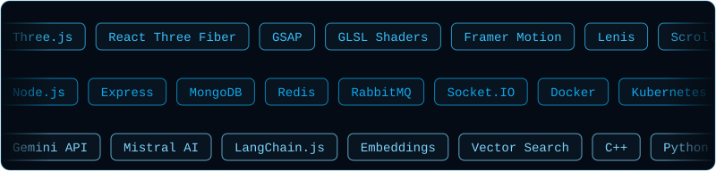

<div align="center">



<br/>


</div>

<br/>

<div align="center">

<br/>

</div>

<br/>

<div align="center">

<br/>

</div>

<br/>

<div align="center">

<br/>

<br/><br/>

<br/>

<br/>

</div>

```glsl
// stack.glsl : what runs in the pipeline
#define CREATIVE   Three.js | React Three Fiber | GSAP | GLSL | Framer Motion | Lenis
#define GENAI      Gemini | Mistral AI | LangChain.js | Embeddings | Vector Search
#define INFRA      Kubernetes | Docker | AWS EKS | Jenkins | Nginx | RabbitMQ | Redis
```

<br/>

<div align="center">

<br/>
<!-- TODO: point each href at the repo or live URL -->
<a href="https://github.com/Luvin-2511"></a>
<br/>
<a href="https://github.com/Luvin-2511"></a>
<br/>
<a href="https://github.com/Luvin-2511"></a>
</div>

<br/>

<div align="center">

<br/>


<!-- These 3 SVGs are generated by .github/workflows/profile.yml into the `output` branch -->


</div>

<br/>

<div align="center">

<br/>

[](mailto:luvin2511@gmail.com)
[](https://linkedin.com/in/luvin-2511)
[](https://portfolio-kappa-three-9z04v2ln1e.vercel.app/)
[](https://leetcode.com/luvin-2511)
[](https://github.com/Luvin-2511)

<br/>

> *"First, solve the problem. Then, write the code."* — John Johnson


</div>
